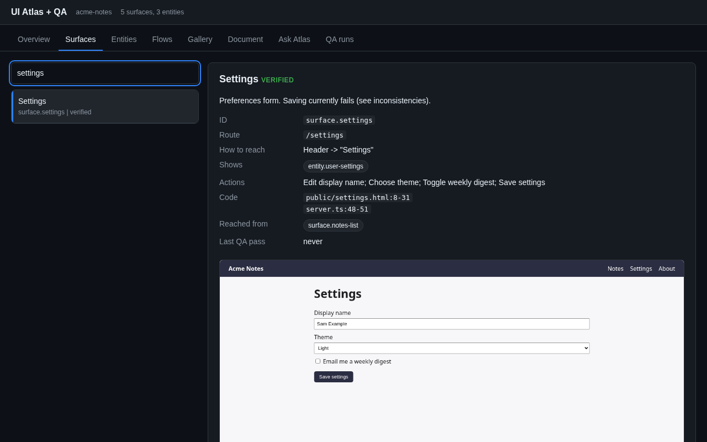
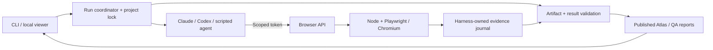

# UI Atlas + QA

**Know your app. Test what matters. Keep the evidence.**

UI Atlas + QA maps a running web app into connected screens, data entities, user flows, source references, and screenshots. Ask where a field appears or how to reach a dialog, then give a testing agent a goal and let it exercise the real app using that map.

Claude Code or Codex supplies the reasoning and visual inspection. Chromium supplies the browser. The harness validates the agent's result and saves a report you can inspect. Everything runs independently of Agent Forge.





## From discovery to a reproducible finding

- **Map more than routes.** Capture pages, dialogs, tabs, meaningful states, and the paths between them. Connect what users see to the data and code behind it.
- **Ask Atlas.** Search the graph offline, or ask an LLM for an explanation with validated citations to real Atlas records.
- **Test with context.** Describe a goal and optionally a code change. The agent consults the Atlas, plans assertions, drives Chromium, examines screenshots, and checks console and network activity.
- **Inspect the evidence.** Browse assertions, findings, and screenshots locally. Export Markdown and JSON reports. Missing or invalid evidence produces an inconclusive result.
- **Keep the map current.** Builds publish only after validation. Interrupted candidates can resume while the last published Atlas stays available. Passing QA assertions record which Atlas surfaces were exercised.
- **Choose your intelligence.** Use the frontier models available through your own Claude Code or Codex installation. Select a model with `--model`; authentication and billing stay with your provider.

## Try it without an LLM account

**Private preview:** cloning currently requires repository access.

Install [Bun](https://bun.sh/) 1.4.4+ and [Node.js](https://nodejs.org/) 20+, then:

```bash
git clone https://github.com/Brian-Coding/AI-UI-Atlas-QA-Tester.git
cd AI-UI-Atlas-QA-Tester
bun install --frozen-lockfile
bun run browsers:install
bun run demo:tour
bun run serve examples/demo-app
```

Open the printed viewer URL, normally <http://127.0.0.1:4477>. The tour starts the fictional Acme Notes app, builds an Atlas with five surfaces, and catches its intentionally broken settings save. A **FAIL** QA report is the expected demo result; the tour itself exits successfully when the bug is detected. The app stops after the tour, while the Atlas and reports remain available.

The tour uses a fixed scripted agent through the same browser API and validation path as an LLM. It makes no model calls. On Linux, missing browser system libraries can be installed with `bunx playwright install --with-deps chromium`.

## Use it on your app

Start your app's development server separately. Install and sign in to [Claude Code](https://code.claude.com/docs/en/overview) or [Codex CLI](https://github.com/openai/codex), then run these commands **from this repository**:

```bash
bun run doctor
bun run atlas build /path/to/app --url http://localhost:3000 --provider claude
bun run atlas query -p /path/to/app "where is the note title shown?"
bun run atlas ask -p /path/to/app "which screens can edit a note?" --provider codex
bun run qa run -p /path/to/app --url http://localhost:3000 --goal "Create a note and confirm it appears in the list" --provider codex
bun run serve /path/to/app
```

`/path/to/app` means your application's source directory. Atlas files go into its `docs/ui-atlas/`; QA evidence stays in its ignored `.atlas-qa/` folder. Neither app startup nor deployment is automated.

Provider agents run with broad local permissions so they can use browser tools without interactive approval prompts. Use a recoverable development environment and test data. The [security guide](docs/security.md) describes the actual boundaries and what is sent to a model provider.

## Learn the workflow

- [Getting started](docs/getting-started.md): installation, demo, first real run, troubleshooting.
- [Build and query an Atlas](docs/atlas.md): coverage, updates, resuming, and Ask Atlas.
- [Browser QA](docs/qa.md): goals, evidence, verdicts, reruns, and CI exit codes.
- [CLI and configuration](docs/cli.md): commands, flags, providers, and storage.
- [Artifact format](docs/artifacts.md): Atlas records, reports, and scripted agents.
- [Security and data](docs/security.md): local access, agent permissions, and sharing artifacts.
- [Performance measurements](docs/performance.md) and [changelog](CHANGELOG.md).
- [Contributing](CONTRIBUTING.md): build, tests, and project structure.

This version tests web applications in Chromium. It does not automate native desktop or mobile controls. Model-driven coverage is exploratory: review the evidence, keep deterministic tests, and treat the Atlas as a dated observation of the app.

## Develop

```bash
bun run check          # TypeScript, unit/integration tests, production viewer bundle
bun run test:browser   # Real Chromium: Atlas, passing/failing QA, and viewer interactions
```

`bun run build` emits `dist/THIRD_PARTY_NOTICES.txt`; include it whenever distributing the built viewer.

The browser test requires the browser installation above. Neither check needs a provider account. See [architecture](docs/architecture.md) for the small set of components behind the workflow.

## License

[MIT](LICENSE). Extracted from [Agent Forge](https://github.com/Brian-Coding/AI-Agent-Forge) and packaged as an independent tool.
